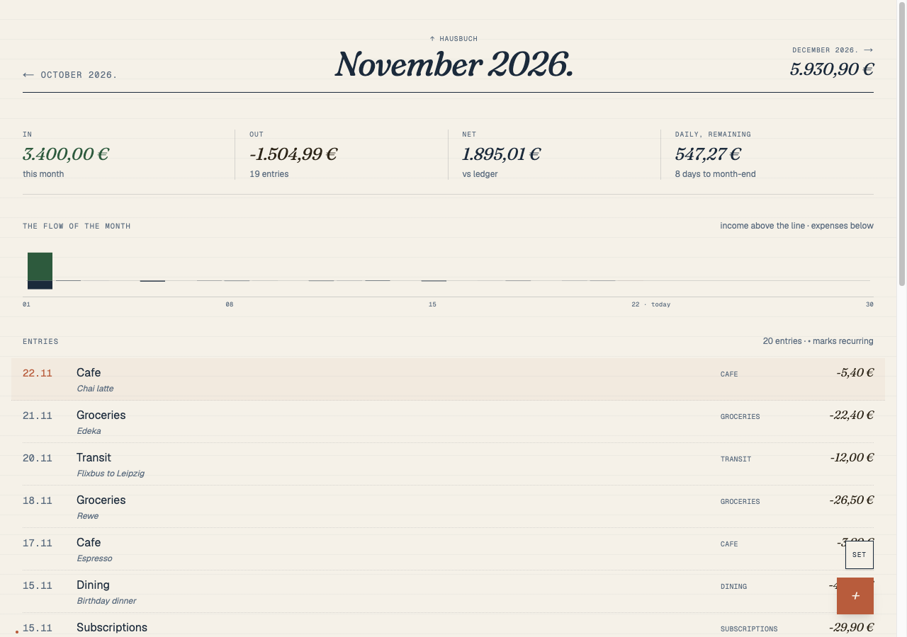
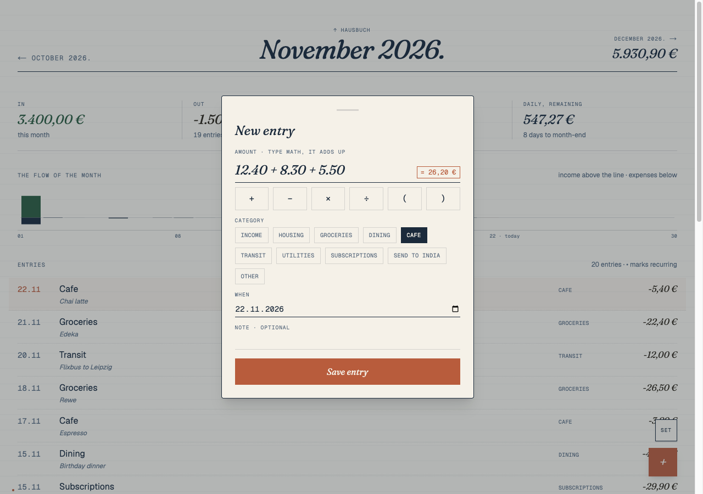

# Hausbuch

A personal expense tracker that reads like a typeset monthly journal. The month is the dashboard.





The live app is single-user (sign-up is closed), so the screenshots use made-up data.

## Develop

```bash
pnpm install
pnpm dev          # http://localhost:3000
pnpm test         # Vitest
pnpm e2e          # Playwright (browsers required)
pnpm build && pnpm start
```

## Stack

Next.js 16 (App Router), React 19, TypeScript strict, Tailwind v4 with custom theme tokens, `next/font` (Fraunces · Geist · Geist Mono), Zustand v5, Recharts, motion, Vitest, Playwright, Biome (lint + format).

## Routes

- `/` → redirects to current month
- `/m/[YYYY-MM]` → the month page (the dashboard)
- `/settings` → sync · recurring · categories · accounts · snapshots · data
- `/api/auth/[...all]` → Better Auth handler (sign in / out / session)

Keyboard shortcuts on the month page: `j` previous month · `k` next month · `n` new entry.

## Storage

The store talks to a `Backend` interface ([src/lib/backend/types.ts](src/lib/backend/types.ts)). The active adapter is selected via `getBackend()` / `setBackend()` ([src/lib/backend/index.ts](src/lib/backend/index.ts)) — defaulting to:

- **RemoteBackend** ([remote.ts](src/lib/backend/remote.ts)) — Postgres via Next.js server actions in [sync-actions.ts](src/lib/sync-actions.ts), which delegate to the typed repository in [repo.ts](src/lib/repo.ts). Authenticated through Better Auth.

A `LocalBackend` (offline-capable, localStorage-backed) is planned but not implemented in v1; the seam is in place so it can drop in without touching the store. Tests inject an in-memory fake backend via `setBackend()` to exercise store mutations without a database.

On first hydration, an empty account is seeded with `SEED_CATEGORIES` / `SEED_ACCOUNTS` via `Backend.migrate()`. Mutations are optimistic (local state updates immediately) and reflected to Postgres in the background; sync status is exposed via the store's `syncStatus` and `pendingWrites`.

The Postgres schema lives in [prisma/schema.prisma](prisma/schema.prisma).

## Local development with the database

```bash
docker compose up -d                # Postgres 17 on :5432
pnpm prisma migrate dev             # apply schema
cp .env.example .env                # then fill BETTER_AUTH_SECRET (openssl rand -base64 32)
pnpm dev
```

## Deploy

The production target is Vercel + Vercel Postgres + the subdomain `hausbuch.yashsuhagiya.com`.

1. **Provision the DB**: in the Vercel dashboard, *Storage → Create database → Postgres*. `DATABASE_URL` is auto-injected into deployments.
2. **Set auth secrets** in Vercel project env: `BETTER_AUTH_SECRET` (`openssl rand -base64 32`), `BETTER_AUTH_URL=https://hausbuch.yashsuhagiya.com`. Optional: `GOOGLE_CLIENT_ID` / `GOOGLE_CLIENT_SECRET` for Google sign-in.
3. **Add the domain**: in Vercel project *Settings → Domains*, add `hausbuch.yashsuhagiya.com`. In your DNS, set a CNAME pointing to `cname.vercel-dns.com.`.
4. **Run the schema migration** against the prod DB on first deploy: `pnpm prisma migrate deploy` (Vercel can run this in the build step via a `postinstall` hook, or run once manually with the prod `DATABASE_URL`).
5. **Update Google OAuth redirect URIs** (if used) to include `https://hausbuch.yashsuhagiya.com/api/auth/callback/google`.

## Design spec

- [docs/superpowers/specs/2026-04-30-hausbuch-expense-tracker-design.md](docs/superpowers/specs/2026-04-30-hausbuch-expense-tracker-design.md)

## Known v1 limitations

- **PWA service worker**: not installed yet. The app has a web manifest and is installable, but offline caching is deferred. `next-pwa` is not yet Turbopack-compatible (Next 16). When workbox + Turbopack ship together, add a service worker.
- **Playwright host platform**: chromium binary doesn't support ubuntu26.04-x64. The E2E test runs on supported CI images (or any host where `pnpm dlx playwright install chromium` succeeds).

## Icons

The favicon, Apple touch icon, and PWA manifest icons are all generated from a single SVG mark by [scripts/generate-icons.mjs](scripts/generate-icons.mjs) — italic "H" in ink on paper with a rust underline, matching the brand. To regenerate after a brand tweak: `node scripts/generate-icons.mjs`. Outputs land in [src/app/icon.png](src/app/icon.png) (favicon), [src/app/apple-icon.png](src/app/apple-icon.png) (iOS home screen), and `public/icon-{192,512}.png` (Android / PWA manifest). Next.js auto-generates the corresponding `<link>` tags from the `src/app/` convention.

## Deferred

| Version | Item |
|---|---|
| v2.1 | Offline write queue + reconnect drain (mutations made offline currently log-and-drop on server failure) |
| v2.2 | Conflict toast when remote `updatedAt` overwrites a local edit (currently last-write-wins silently) |
| v1.2 | Search and filter across all months |
| v1.3 | Monthly close ritual — auto-generated narrative |
| vNext | Eras (life chapters); UI for `chapterId` |
| vFuture | Multi-user / joint mode |
| vFuture | Receipt photo capture |
| vFuture | Multi-currency |

## Brand

The visual language is "ruled paper, ink type, italic numbers". Tokens are defined in [src/app/globals.css](src/app/globals.css) under `@theme`:

| Token | Value | Use |
|---|---|---|
| `--color-paper` | `#F5F1E8` | page background |
| `--color-ink` | `#1B2A3B` | body type, primary borders |
| `--color-rust` | `#B85C3C` | accent, primary action, "today" |
| `--color-sage` | `#5A6B7E` | secondary type, labels |
| `--color-green` | `#2D5A3D` | income amounts |
| `--color-charcoal` | `#2C2417` | expense amounts |

Type roles:

- **Fraunces** italic — display, amounts, page titles
- **Geist** — body, navigation
- **Geist Mono** — tabular numbers, dates, uppercase labels
